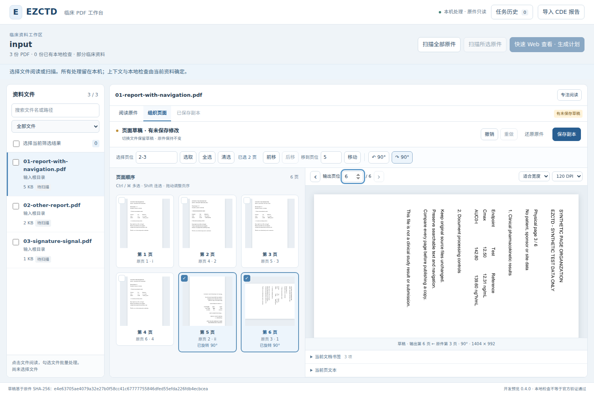
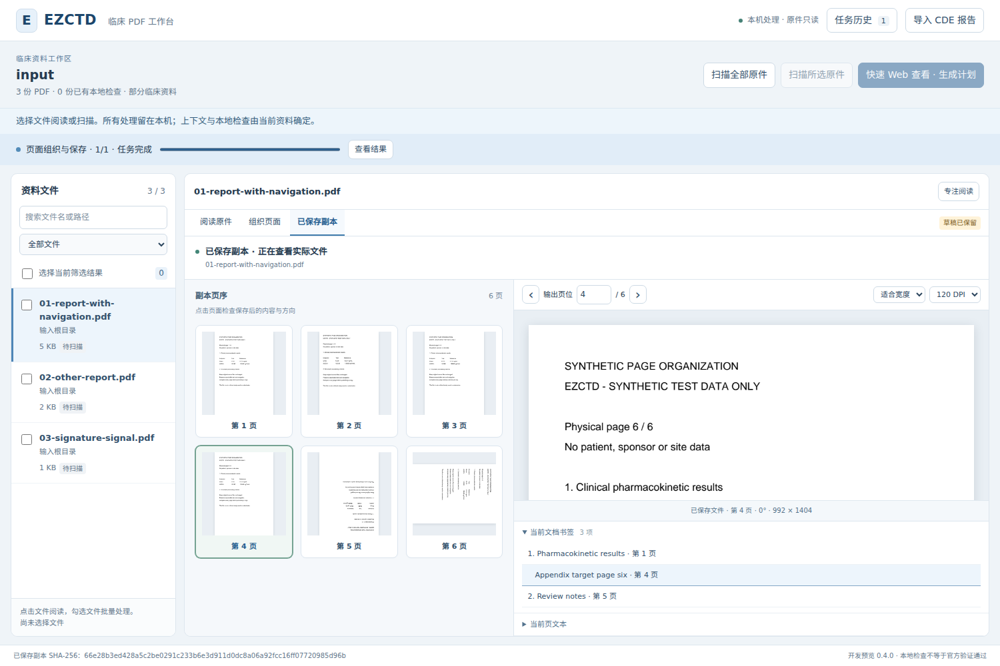
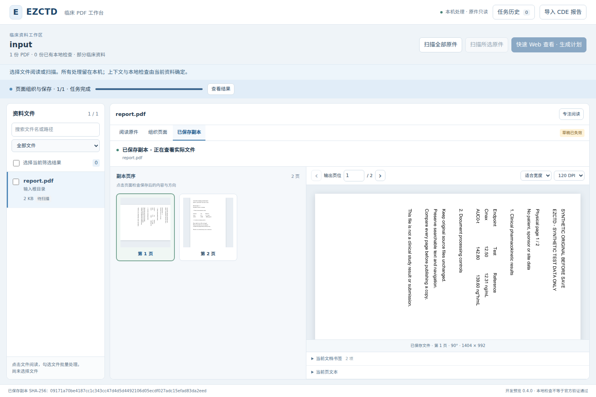

# 页面组织工作台 · 实际验证记录

日期：2026-10-10。继续 `codex/pdfcraft-workbench` 与 Draft PR #2。此次交付单文档完整页集的重排、持久旋转、编辑历史和实际副本重开，保留此前阅读与批次功能。本文的本地结果已实际运行；远程当前提交 CI 以 PR Checks 及对应 Actions artifacts 为准。

## 来源与范围

开始与提交前核对的 main 为 `16641563e7385722b260bb37c53595f96215e1f7`；本阶段父提交为 PR head `11d828856d09511c1149493c4fbcee28aa8a84cd`，完整树为 `33b2663a45486369ab920a62eddde20ac3b537ff`。本地为已核对源文件的部分快照，远程新树以该完整树为 base，仅修改本次清单路径，不删除未取材的历史资产。

固定参考 PDFCraft `306bbcedf98b3a22f276e333d70688c776897154` 的工作台、选择/编辑命令、组织引擎和保存路径。未构建或运行上游 GUI。适配依据见 [设计记录](../../specs/pdfcraft-workbench/design.md)；没有移植品牌、资源、Rust 运行时或默认有损压缩。

最终应用与测试的 42 个文件在执行前冻结，执行后 SHA 全部相同，见 [源码清单](tested-source-sha256.json)。浏览器另独立核对全部 24 个 Python 源文件及 4 个前端文件的前后身份。

## 完整本地结果

| 检查 | 实际结果 | 原始证据 |
| --- | --- | --- |
| 全部核心回归 | **262 passed，0 failed/error/skipped**；20.91 秒 | [JUnit](local-core-junit.xml)、[实际命令](core-command.json) |
| 真实本机 HTTP / Chromium | **42 项 PASS**；0 非预期错误、0 外部请求；32.886 秒 | [浏览器结果](local-browser-result.json)、[实际命令](browser-command.json) |
| 普通输入完整性 | 原阅读/恢复 11 份 + 页面组织 3 份，合计 **14 份 SHA 不变** | 浏览器结果各 integrity 字段 |
| 规划及规则矩阵 | PASS；26 规则 / 163 案例，130 implemented、22 specified、11 blocked | [规划与 smoke](planning-and-smoke.json) |
| 合成 smoke | 28 份生成，28/28 结构检查通过 | 同上 |
| 语法及补丁检查 | 两份 JS、Python compileall、git diff --check 通过 | [命令结果](syntax-and-whitespace.json) |

核心环境：Linux x86_64 / Python 3.12.14；ezctd 0.4.0.dev0、pikepdf 10.16.0、pypdfium2 5.13.0、Pillow 12.3.0、pytest 9.1.1。详见 [环境记录](environment.json)。浏览器使用已安装的隔离 Playwright 1.55.0 与 Chromium 140.0.7339.16。Browser 插件未提供，因此采用仓库既有 Playwright 脚本；没有修改浏览器策略或仓库依赖范围。

完整入口仍是 `python tools/review/test_workbench_browser.py NEW_DIR --browser /path/to/chromium`。它运行原有 28 项流程和新增 14 项页面组织流程；不是仅打开 HTML 或模拟保存响应。核心中的原生页面组织 49 例已包含在 262 例中，独立复核的子集不重复累加。

## 实际保存了什么

浏览器通过真实按钮将 6 页报告的第 2–3 页移到第 5 页位，再顺时针旋转。该原件已有第 2 页 90° 旋转、第 4 页 CropBox、罗马/阿拉伯标签、多层书签、普通链接和命名目的地。

独立于保存证明，测试用 pikepdf 与 PDFium 重开最终发布的 PDF，得到：

| 核对项 | 实际输出 |
| --- | --- |
| 各输出页对应来源页 | `1, 4, 5, 6, 2, 3` |
| 绝对旋转 | `0°, 0°, 0°, 0°, 180°, 90°` |
| 页面标签 | `i, 2, 3, 4, ii, 1` |
| 原书签目标：来源 1 / 来源 6 / 来源 2 | 输出 1 / 输出 4 / 输出 5 |
| 原普通链接：来源 1 → 来源 4 | 输出 1 → 输出 2 |
| 原命名链接：来源 3 → 来源 5 | 输出 6 → 输出 3 |

实际输出页序从每页正文中的独特来源标记读取，方向和标签从 PDFium 读取，书签与链接从保存后的 PDF 对象读取；没有只信任界面或证明中的 `VERIFIED` 字段。证明的源/输出 SHA 也与实际文件比对。见 [输出核对与证明](published-pdf-evidence.json)。

## 故障与并发验证

- 真实 Shift 多选与指针拖动移动整组页面，撤销恢复原序；后续移动、旋转、两次撤销/重做、切换文件保留草稿均通过。
- 延迟一个真实旧修订的原生预览，旋转后再交付该响应；新修订号、页面和画布像素保持一致，没有用伪造 PNG 代替引擎。
- 保存请求由服务器实际接受，浏览器故意丢失保存响应和首次状态查询。专用“重新连接”找到同一任务，浏览器只发送一次保存，输出只有一份，旋转没有重复。
- 另一个隔离控制在真实副本发布后故意把 2 页合成原件替换为 3 页。真实 `SOURCE_CHANGED` 使草稿失效；历史按同一 draft/revision 找回已经发布的 2 页输出，其 SHA 始终不变。界面分别显示“草稿已失效”和有效副本的绿色状态。
- 原有计划失效 A/B 控制继续保留：只按预期改变 A，B 不变。上述故意改源的 3 份控制输入与 14 份普通未改输入分开统计。

浏览器 JSON 保留全部预期诊断：8 条记在通用故障控制字段，5 条记在改源控制字段；合计包括 10 条主动注入的网络/HTTP 失败和 3 条故意改源产生的真实身份错误。它们不计为意外脚本错误，也不能据此声称从未发生 HTTP 错误。普通编辑的 [HTTP 错误诊断](normal-editor-http-diagnostics.json) 为空。

## 开发失败与修正依据

| 发现 | 实际失败与修正 |
| --- | --- |
| 页对象身份 | 实测页序列切片赋值会复制页字典，原书签可能保留旧对象引用。改为移动既有页树叶引用，保留间接页对象、嵌套树和继承属性。 |
| 远程目的地被当成本地页号 | 初轮原生 35 通过、4 失败，错误 `PDFium link target outside document`。PDFium 对 GoToR 也可能暴露整数目标；现明确按 action type 分离本地与远程目标，远程值保留且不跟随打开。 |
| 既有旋转的参考模型 | 新增逆操作出现 `Mapped rendered page pixels differ: 2`。查看器额外旋转与持久 Rotate 不总等效；现从独立原件页设置绝对目标方向作为预期。保留 270° + 180°、分数 CropBox、普通及 NoRotate 可见注释和 AP 字节断言。 |
| 首轮浏览器 | [R1 原始失败](browser-first-run-failure.json)：实际输出检查已过，但测试在 UI 轮询前点击副本模式，被随后弹出的结果框遮挡；修正为等待实际结果按钮。另有 11 条未及时取消的旧修订读取 409，加入分组 AbortController，保留服务端修订保护。该轮源码也有并发变化，不能作为最终版本验收。 |
| 异步预览与来源失效 | 最终身份检查、修订检查、缓存写入和返回移到同一锁边界；首次预检记录来源失效代次，避免检查窗口内创建失效草稿；已观察改源会取消在途保存。 |
| 已保存输出的永久失效 | 真实 page/navigation 读取交错显示，另一请求已标记失效后旧请求仍能返回，或原生读到不同字节后恢复原字节仍能重读。最终注册身份与失效标记复核、实际原生变化永久失效后通过。 |
| PDF + proof 事务 | proof 已发布后临时清理 PermissionError 曾留下孤立证明；事后 lstat 建立所有权还可能误删第三方替换文件。正常返回与异常都从 writer 文件描述符取得原 inode 回执，事务只回滚仍属于自己的文件。两类替换样例保留真实不同 inode。 |
| 合法旧式名称 | `/Caf#e9` 这类合法非 UTF-8 Name 曾抛编码异常。名称键无损恢复原字节，语义指纹仅对无法解码的 Name 使用原字节 hex；普通 Name 表示不变，改变字节仍使指纹不同。ASCII、中文与非 UTF-8 名称均经真实保存重开验证。 |
| 副本与草稿的显示身份 | 截图发现已失效原件把独立有效副本状态点染红；现按副本自身身份显示，失效草稿另用明确徽标。最终真实浏览器包含两项断言。 |

[R1–R4 迭代记录](focused-browser-iterations.json) 保留每轮结果和实际源码身份。原失败样例、反例与预期没有为通过而删除或放宽；完整最终结果只以上面的 262 / 42 为准。

## 独立复核与未完成项

原生实现者只读复核 API、草稿、保存与输出读取；后端实现者只读复核页树、导航、旋转、标签及逐页证明；根代理复核浏览器、实际副本、来源身份和发布所有权。已复现的问题均补修并定点回归，随后统一冻结执行完整测试。这些 AI 审查不代替另一位开发者实际试用。

当前只支持单文档完整页集的重排/旋转。提取、拆分、合并、插入/删除、书签/链接编辑、页面标签编辑、OCR、有损压缩等未在本阶段交付。草稿与输出登记限当前服务会话，最多 16 份草稿、每份 50 步历史；文件上限 2,000 页、200 MiB。签名、加密、表单、附件等既有重写守卫继续保留。

没有运行真实临床/纸质签章业务、公司 Windows 10/11 或 NAS 验收、密码学签名验证、CDE 官方程序及另一人产品验收。Hosted Windows CI 的当前提交结果需另行读取，不能替代上述环境。按照仓库 `AGENTS.md`，此 PR 保留给另一人实际试用与审核，合并仍需明确指令。试用见 [0.4 工作台说明](../../development/WORKBENCH_0_4.md)。

## 实际界面

### 多选、重排与真实旋转预览

### 打开实际副本并跳转原有书签

### 原件变化后仍可查看已保存副本

[1000px 截图](organizer-1000.png) · [390px 截图](organizer-390.png) · [保存回执丢失](organizer-save-unknown.png) · [恢复同一输出](organizer-save-recovered.png) · [截图复核](visual-review.json)
