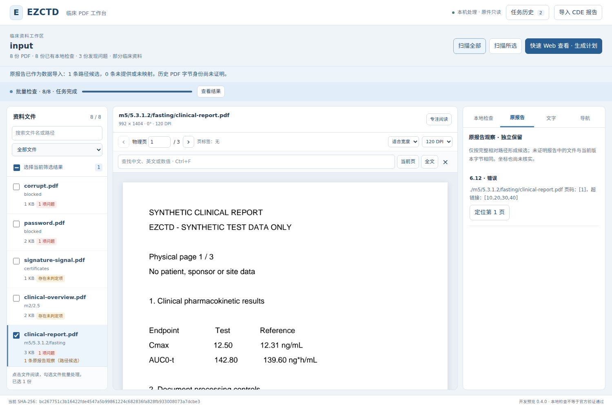
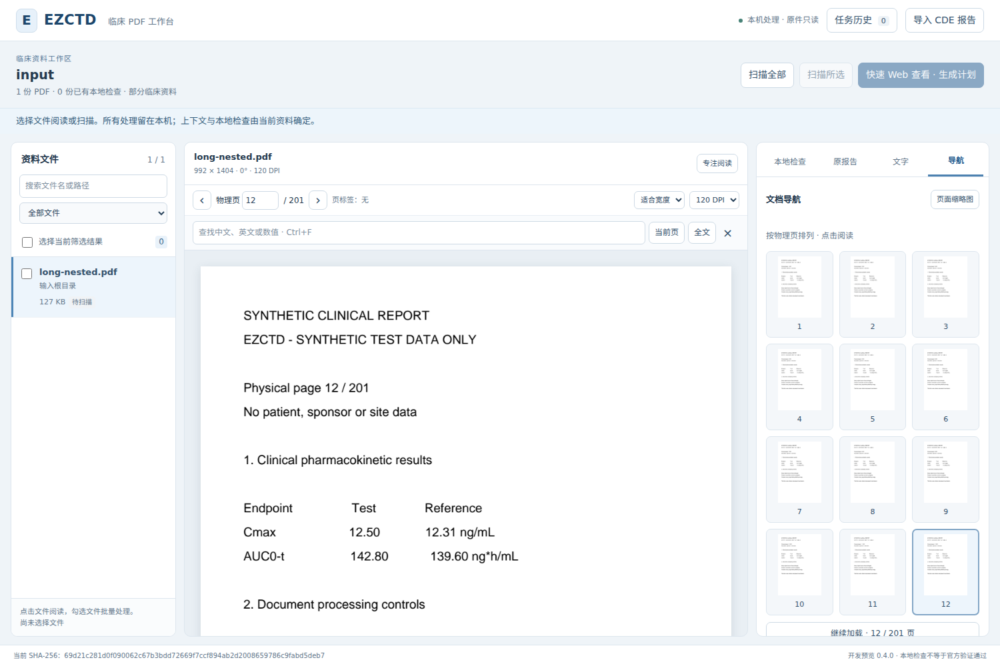
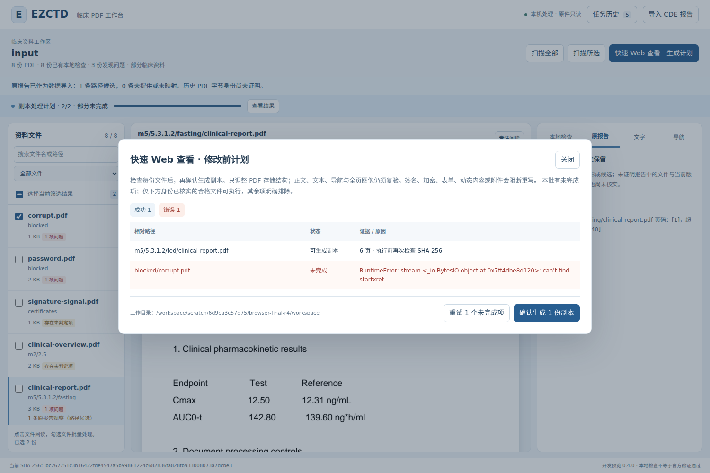
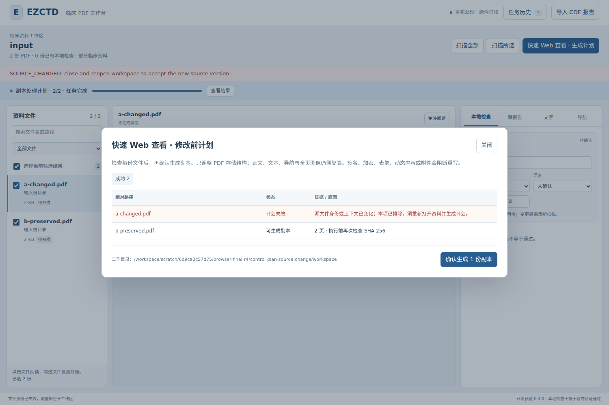

# 0.4 本地验证与来源记录

日期：2026-10-10。任务分支：`codex/pdfcraft-workbench`。

本文件记录本轮实际执行的本地检查；PR 的当前提交 CI 以该 PR 的 Checks 和 Actions artifacts 为准。下列结果不继承 0.3 的历史 CI，也不表示官方合规或人工验收已经完成。

## 固定来源

| 项目 | 固定身份 |
| --- | --- |
| EZCTD 开始与提交前核对的 main | `16641563e7385722b260bb37c53595f96215e1f7` |
| main 原始完整树 | `785dc1344c62cc9c226b388726ec671a2373e1fb` |
| PDFCraft 阅读版本 | `306bbcedf98b3a22f276e333d70688c776897154` |
| 本轮应用源码及测试 | [SHA-256 清单](tested-source-sha256.json) |

本地基线通过 GitHub 逐文件读取，原始 UTF-8 字节按 Git blob SHA 验证。只取材本轮需要的代码、测试、当前文档、CI 和规则数据；没有把未下载的历史资产当作待删除文件。远程提交须以原 main 完整树为 base，只替换本任务变更路径，保留历史研究与证据。PDFCraft 阅读了 40 余份相关文件，没有构建或运行它；代码依据和适配判断见 [设计](../../specs/pdfcraft-workbench/design.md)。

## 本地检查

| 检查 | 实际结果 | 证据 |
| --- | --- | --- |
| 全部核心测试 | **163 passed，0 failed，0 error，0 skipped**；11.17 秒 | [JUnit](local-core-junit.xml) |
| 规划资料校验 | PASS；26 个唯一规则 | `python scripts/validate_artifacts.py` |
| P0-B0 矩阵 | PASS；26 规则/163 案例；130 implemented、22 specified、11 blocked | `python scripts/validate_p0b0_matrix.py` |
| 合成 smoke corpus | 28 个案例生成；28/28 结构检查通过 | 原生成器和 `python scripts/inspect_p0b0_smoke.py` |
| JavaScript / Python 语法与补丁空白 | PASS | `node --check src/ezctd/web/app.js`、`compileall`、`git diff --check` |
| 真实本机 HTTP/Chromium | **28 项通过**；0 非预期浏览器错误、0 外联；25 份应用源文件运行前后不变 | [最终结果](local-browser-result.json)、[像素对照](page-query-evidence.json)、[截图复核](visual-review.json) |

实际命令：

```bash
python -m pytest -q tests/cro_pdf --junitxml=final-core-junit.xml
python scripts/validate_artifacts.py
python scripts/validate_p0b0_matrix.py
python tools/corpus/build_pdf_fixtures.py --output tests/corpus/generated-smoke --mode smoke
python scripts/inspect_p0b0_smoke.py
node --check src/ezctd/web/app.js
python -m compileall -q src/ezctd
git diff --check
```

核心环境：Linux x86_64，Python 3.12.14，pikepdf 10.16.0，pypdfium2 5.13.0，Pillow 12.3.0，pytest 9.1.1。执行核心测试时，editable 安装元数据仍显示初装的 0.3，而已核对的实际源码是 0.4；随后使用 `pip install --no-deps -e .` 成功同步到 0.4，未改变上述依赖。最终浏览器同时记录源码与安装版本。

浏览器环境：隔离的 Playwright 1.55.0、Chromium 140.0.7339.16（headless shell revision 1187），使用仓库 `--browser` 参数选择实际已安装的引擎。共享环境中的 Playwright 1.63.0 没有被替换；本轮也没有更改仓库支持的依赖范围或浏览器策略。

最终浏览器命令使用隔离目录的 `PYTHONPATH` 和 `PLAYWRIGHT_BROWSERS_PATH`，运行 `python tools/review/test_workbench_browser.py /workspace/scratch/6d9ca3c57d75/browser-final-r4 --browser /workspace/scratch/6d9ca3c57d75/browser-engines/chromium_headless_shell-1187/chrome-linux/headless_shell`。这是实际 Chromium 和真实原生引擎路径，不是静态 HTML 或模拟 PDF 输出。

主流程 8 份、长文档 1 份、两个断线恢复会话各 1 份，合计 **11 份合成输入哈希不变**。计划失效用例另有 A/B 两份合成文件：测试故意给 A 追加固定注释，实测 SHA 必须恰好等于预期改动，B 保持不变；它们不计入 11 份未改源结论。真实读取返回 `SOURCE_CHANGED`，计划可执行数由 2 变为 1，历史逐行标签和确认按钮一致。

28 项包括有意的反例：6 条注入断线/HTTP 诊断与 1 条故意改源产生的真实原生诊断在 JSON 中分别保留，不能把它们称为 7 个意外错误，也不能写成从未发生 HTTP 错误。独立截图复核还发现并修正了成功恢复后残留的旧“状态未知”提示；最终两个恢复分支均验证该旧提示消失，同时保留无关的源身份错误。

## 正反用例的证据范围

- 原生 PDF 用例覆盖页标签、裁剪/旋转坐标、命中片段、每页 500 次精确边界和截断下界、分批覆盖、无文本页、超大页全页预算渲染、有界导航，以及混合计划的真实线性化与证明文件。
- 缓存/取消/记录保存竞态采用真实合成 PDF 或 worker，加明确的进程内调度钩子。钩子负责固定事件顺序，不代表真实临床文件、恶意 OS 环境或完整安全沙箱。
- 浏览器的主流程使用真实 HTTP 服务、原生 PDFium/pikepdf、实际 PNG/文本/命中坐标和副本证明。断线、普通页面错误和来源失效提示的控制响应在结果中单列；预期的 HTTP 错误控制台信息与意外脚本错误分别记录。
- 浏览器结果会核对整个运行期间所有 22 个 Python 源文件和 3 个前端文件的前后哈希。源码变化的一轮不能冒充最终版验证。
- 任务 JSON 是保存当时的历史预检快照；之后观察到的失效由当前会话的 `invalidated_plan_ids` 和可执行集合表达，不覆盖旧 JSON，不授予跨会话计划重放权限。

## 失败过程与修正依据

| 运行 | 实际结果及后续处理 |
| --- | --- |
| [首轮核心基线](baseline-core-junit.xml) | 102 passed、2 failed。其中一项来自取材时缺失固定规则源件，补取并核对 Git blob 后通过，不能算产品缺陷；另一项是原生 worker 在完成时收到取消仍返回 OK，重复复现后修复并加入确定性回归。 |
| [初始浏览器启动](browser-install-failure.json) | 缺少 Playwright 1.63 所需的 Chromium 1243；安装下载得到无效 ZIP。没有将未启动写为测试通过。 |
| [原界面浏览器基点](browser-original-ui.json) | 10 项原有交互通过、8 份输入不变。此时使用原界面和正在开发的后端，仅作为界面回归基点，不能声称完整未修改的 main 集成基线。 |
| [新界面选择器失败](browser-selector-failure.json) | 前 15 项通过；测试按整条可见路径定位失败，因为文件名与目录已分成两个节点。改用界面已有的完整路径 title，保留原断言。 |
| [运行期间 UI 改动](browser-source-changed-during-run.json) | 20 项交互完成，但整体 FAIL：运行期间 app.js 变化。保留失败，不能计为稳定最终版通过。 |
| [双响应控制器失败](browser-controlled-route-failure.json) | 前 22 项通过，整体 FAIL：Playwright 的 `times=2` 在两份在途响应尚未释放时卸载拦截，导致重复处理错误。修正为释放后卸载；“折叠再展开必须得到 12 张真实缩略图”的断言不变。 |
| [27 项中间版本](browser-before-final-recovery-message.json) / [28 项计划失效版本](browser-plan-invalidation-before-recovery-message.json) | 各自稳定通过；截图检查发现成功恢复后还留有旧断线提示，随后修正并增加断言。最终结果只指向上表的 `local-browser-result.json`，不把中间版本冒充最终代码。 |

没有为绿色结果删除原测试、降低期望、替换固定样例、放宽 CSP 或改写历史官方数据。

## 独立审查

阅读实现作者复核批次/缓存/API；批次实现作者复核根界面；另一审查者完成真实浏览器回归。复现并修复缓存取得后改源/关闭、JSON 解析期间取消、保存记录期间已观察失效的计划重新注册、迟到查询高亮、双断线后按钮无法恢复、缩略图折叠假完成和历史计划行标签不一致。

修复后独立实跑了 26 个工作区/API 用例，以及父进程不加载原生引擎的 1 个针对性用例；另一次相关完整组合为 67 passed。以上是同一套核心用例的不同检查组合，**不与 163 项相加**。

## 尚未运行或完成

本地没有 Windows 10/11、NAS、真实临床/纸质签章业务验证、CDE 官方程序或人工产品验收。Hosted Windows CI 必须读取本 PR 当前提交的实际结果后再记录，且不能代替公司电脑和 NAS。当前历史仅覆盖一个服务进程；关闭重开后重新扫描和计划。

另一位开发者的实际试用步骤见 [0.4 使用说明](../../development/WORKBENCH_0_4.md)。按照仓库 `AGENTS.md`，自动检查和两个 AI 的审查不能代替另一人试用、审核和明确合并指令。

## 真实合成界面

### 阅读与目录



### 长文档的缩略图导航



### 混合计划



### 计划后来源变化



[1000px 窗口实际截图](workbench-1000.png) 显示工具条和页脚可达，无文档级横向溢出。
